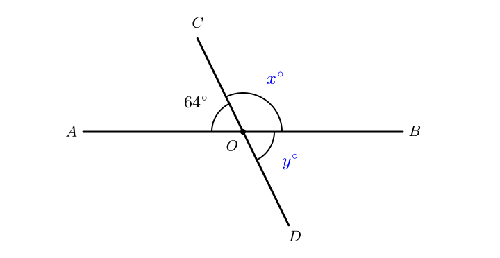
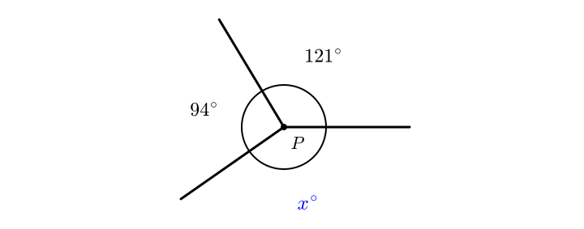
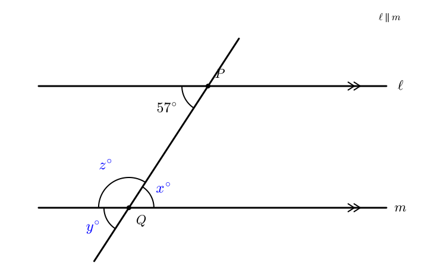
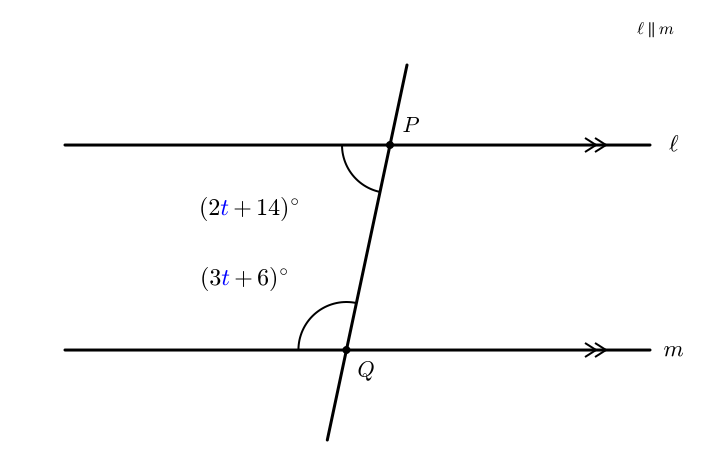
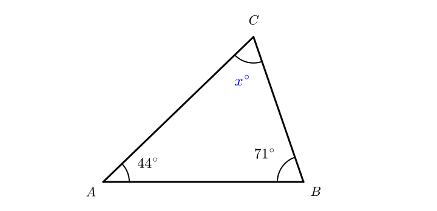
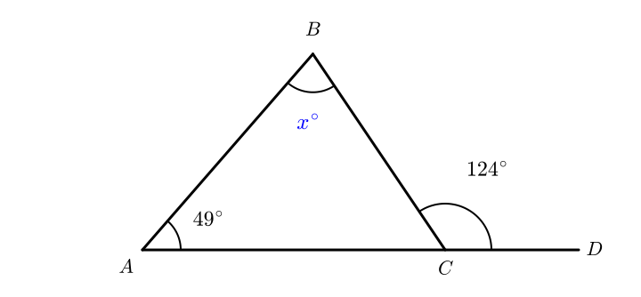
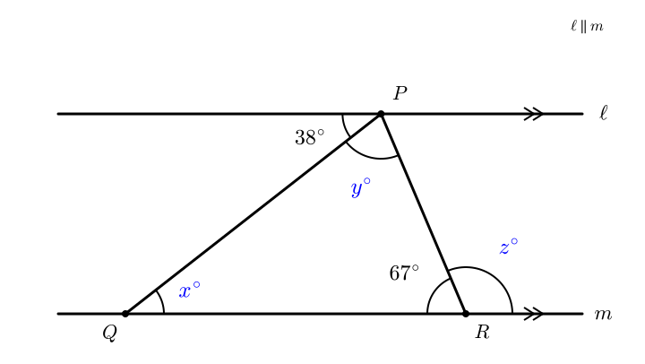
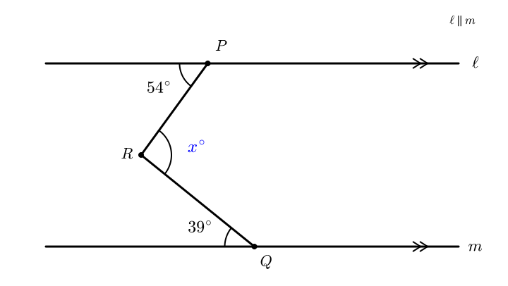

# Year 7 Geometry: Explain Your Angle Reasoning

[Home](index.md) | [Teaching Resources](teaching-resources.md) | [Digital Citizenship](digital-citizenship.md) | [Professional Learning](professional-learning.md) | [Speech](speech.md) | [References](references.md)

**Curriculum:** [AC9M7M04 and AC9M7M05](https://www.australiancurriculum.edu.au/resources/work-samples/mathematics/year-7/ws01-geometric-reasoning/).

- Pause before each result. Predict the next step.
- Replay as needed. Each clip is silent.

- **Core:** Q2, Q4, Q7 and Q10.
- **Developing:** Q1, Q3, Q5, Q6, Q8 and Q9.
- **Challenge:** Q11, Q12.

## 1. Angles at a point

Animation · 1:47

https://github.com/user-attachments/assets/10071964-09a2-43e7-b316-02f75d43bcc4

Exercises · Q1–Q3

### Q1. Classify

- Classify $38^\circ$, $90^\circ$, $147^\circ$ and $232^\circ$. Use: acute, right, obtuse or reflex.

### Q2. Intersecting lines

### Q3. One full turn

## 2. Parallel lines

Animation · 2:29

https://github.com/user-attachments/assets/cceb9b30-2919-457e-8a18-71b4556c4a80

Exercises · Q4–Q6

### Q4. Identify the relationship

### Q5. Check a claim

> “Corresponding angles are always equal.”

- Is this statement complete?
- State the missing condition.

### Q6. Co-interior angles

## 3. Triangles

Animation · 2:49

https://github.com/user-attachments/assets/674f61ea-5a5a-4dbc-8bbc-0ac2fb1add30

Exercises · Q7–Q9

### Q7. Triangle angle sum

### Q8. Isosceles triangle

- Sketch $\triangle PQR$ with $PQ = PR$.
- $\angle QPR = 46^\circ$.
- Find $\angle PQR$ and $\angle PRQ$.

### Q9. Exterior angle

## 4. Combined reasoning

Example A · Add a parallel line · 1:40

[Watch worked example A](animations/Question%201%20Animation.mp4)

Example B · Resolve a reflex angle · 1:20

[Watch worked example B](animations/Question%202%20Animation.mp4)

Exercises · Q10–Q12

### Q10. Parallel lines and a triangle

### Q11. Add a construction line

### Q12. Test the relationship

- Keep the two given angles in Q11 unchanged.
- Move the parallel lines farther apart.
- Would $x$ change? Explain.

## 5. Check your work

Answers and reasons

| Question | Answer | Key reason |
|---|---|---|
| Q1 | Acute; right; obtuse; reflex | Compare with $90^\circ$ and $180^\circ$ |
| Q2 | $x = 116^\circ$; $y = 64^\circ$ | Straight line; vertically opposite angles |
| Q3 | $x = 145^\circ$ | $360^\circ - 121^\circ - 94^\circ$ |
| Q4 | $x = 57^\circ$; $y = 57^\circ$; $z = 123^\circ$ | Alternate; corresponding; co-interior |
| Q5 | Only when the two lines are parallel | Check the condition |
| Q6 | $t = 32$; angles $78^\circ$ and $102^\circ$ | $5t + 20 = 180$ |
| Q7 | $x = 65^\circ$ | $180^\circ - 44^\circ - 71^\circ$; justify using alternate angles |
| Q8 | $\angle PQR = \angle PRQ = 67^\circ$ | Equal base angles; $\frac{180^\circ - 46^\circ}{2}$ |
| Q9 | $x = 75^\circ$ | Exterior angle: $124^\circ - 49^\circ$ |
| Q10 | $x = 38^\circ$; $y = 75^\circ$; $z = 113^\circ$ | Alternate angles; triangle sum; straight line |
| Q11 | $x = 93^\circ$ | Through $R$, draw a parallel line; add $54^\circ$ and $39^\circ$ |
| Q12 | No. $x$ stays $93^\circ$ | The two transferred angles remain $54^\circ$ and $39^\circ$ |

---

[Home](index.md) | [Teaching Resources](teaching-resources.md) | [Digital Citizenship](digital-citizenship.md) | [Professional Learning](professional-learning.md) | [Speech](speech.md) | [References](references.md)
